# 面经本 · 面试题库与知识点

> 一个本地优先的面试题库：按面试归档题目，答案可以先空着；概念、命令、踩坑单独记到知识点。数据保存在自己的电脑上，不上传云端。


<p align="center">
  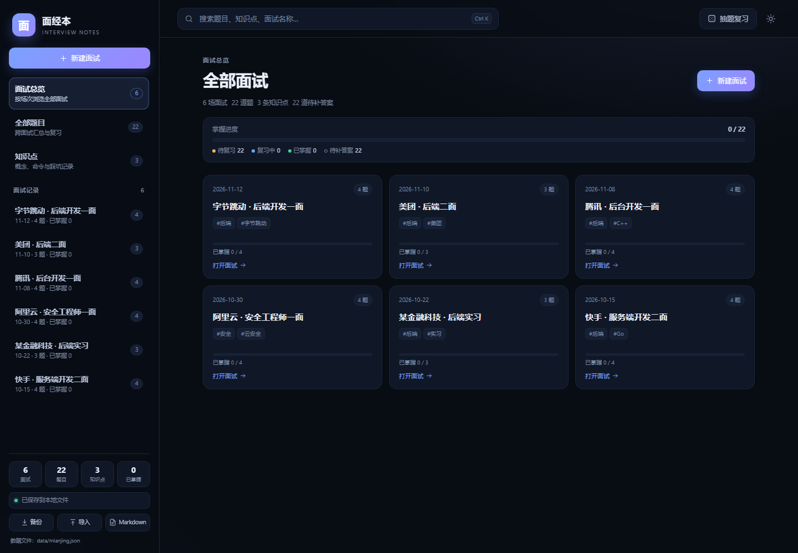
</p>

## 功能

- **面试总览**：卡片展示全部面试，包含日期、题量、标签、掌握进度，点击进入
- **题目管理**：新建面试，一行一题批量粘贴，自动去掉 `1.`、`-`、`Q:` 等序号
- **答案可留空**：先收集题目，答案之后再补；支持待复习 / 复习中 / 已掌握
- **标签库**：先建好分类和颜色的标签，录入面试、题目、知识点时直接点选；支持批量新建、重命名和删除
- **批量标签**：标签选择器里粘贴多行，每行自动创建并选中一个标签
- **知识点库**：单独记录概念、命令、踩坑和代码片段；默认展示全文，可进入专注阅读，支持标签、编辑删除
- **Markdown**：知识点内容、题目答案和面试备注支持 Markdown，编辑器内可预览；支持标题、列表、代码块、表格、引用、链接
- **知识点大分类**：内网渗透、Java、免杀等大分类，可筛选、改名、删除，编辑时直接选择
- **卡片快捷操作**：知识点列表里直接切换分类、编辑标签；拖右上角把手到分类即可归类
- **题目转知识点**：题目底部一键转换，题目作为标题，答案自动填入内容，标签一起带过去；知识点卡片可一键跳回原题
- **全屏写作**：题目、答案和知识点都在全屏编辑器中完成，保存后自动退出回到原位置
- **返回上一页**：从面试总览、全部题目或搜索结果进入面试后，一键返回并保留来源、筛选和滚动位置
- **分类搜索**：同时搜索面试、题目、知识点；结果可按「全部 / 面试 / 题目 / 知识点」切换
- **随机抽题**：遮住答案自测，适合面试前快速过题
- **标签与难度**：按主题整理，按标签筛选
- **本地备份**：JSON 导出 / 导入、Markdown 导出
- **深色 / 浅色主题**：右上角切换，移动端自适应

<p align="center">
  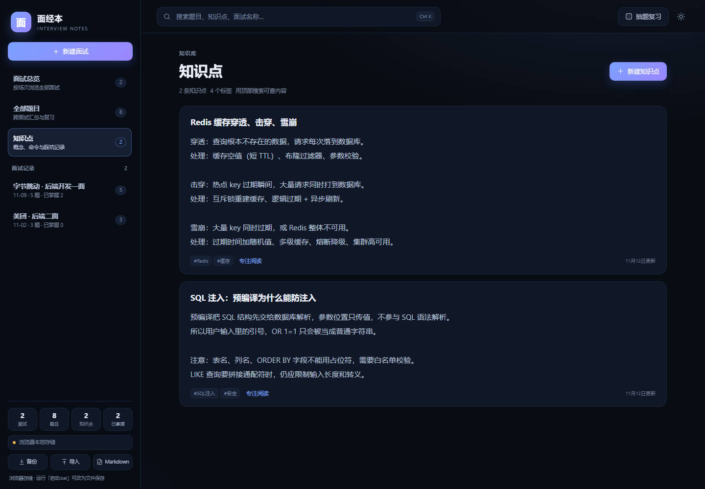
</p>

<p align="center">
  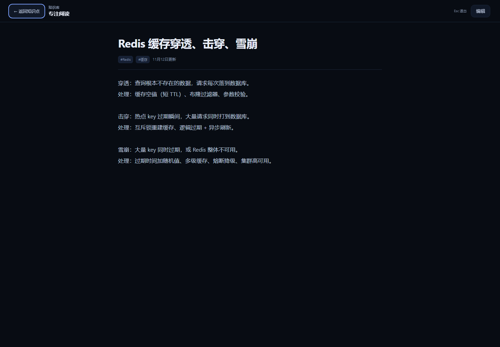
</p>

<p align="center">
  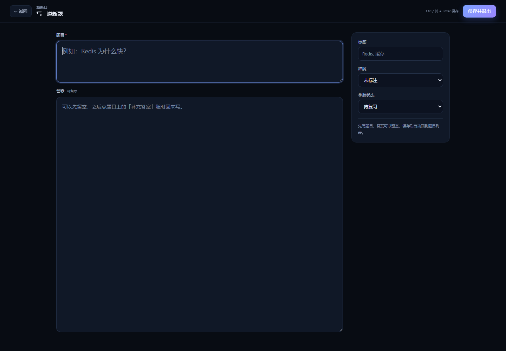
</p>

## 标签库

面试、题目、知识点里的标签都改成从标签库点选，不再每次手写：

- 可以批量新建标签，按「技术栈 / 公司 / 方向」等分类
- 支持 8 种颜色标记
- 修改标签名会同步更新所有引用它的内容
- 删除标签会从所有内容中移除，并二次确认
- 第一次打开时，已有内容里的标签会自动收进「未分类」，之后可以慢慢整理

<p align="center">
  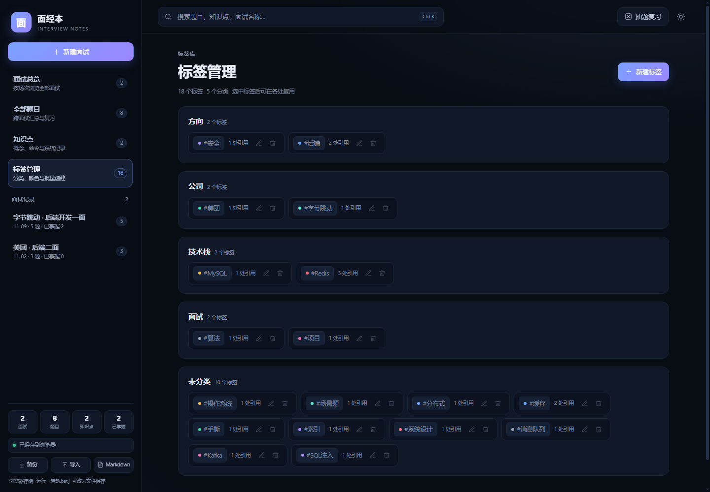
</p>

标签选择器里可以直接批量添加：点「批量添加」，一行一个标签，自动去重、创建并选中。

<p align="center">
  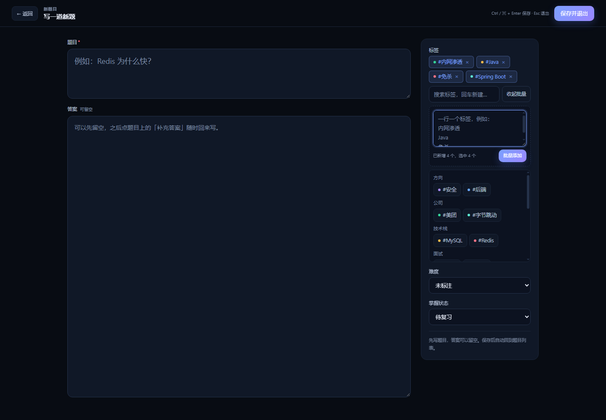
</p>

## 知识点快捷操作

不用进入知识点编辑器，在列表里就能改：

- 标题下方直接下拉切换大分类
- 「编辑标签」在卡片内展开标签选择器，支持批量添加
- 拖动右上角把手到上方分类胶囊，松手自动归类
- 从题目转化来的知识点会显示「原题 · 面试名」，点击跳回具体题目并高亮

<p align="center">
  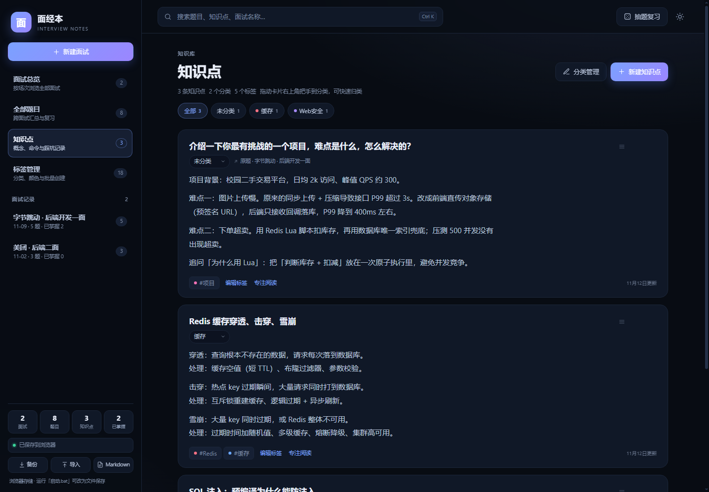
</p>

## Markdown 写作

知识点内容、题目答案和面试备注都可以写 Markdown：

- 编辑器里有「预览 / 继续编辑」
- 支持标题、加粗、斜体、删除线、列表、引用、代码块、表格、行内代码、链接和图片
- 保存后，知识点卡片、答案区、专注阅读模式都会按 Markdown 渲染

<p align="center">
  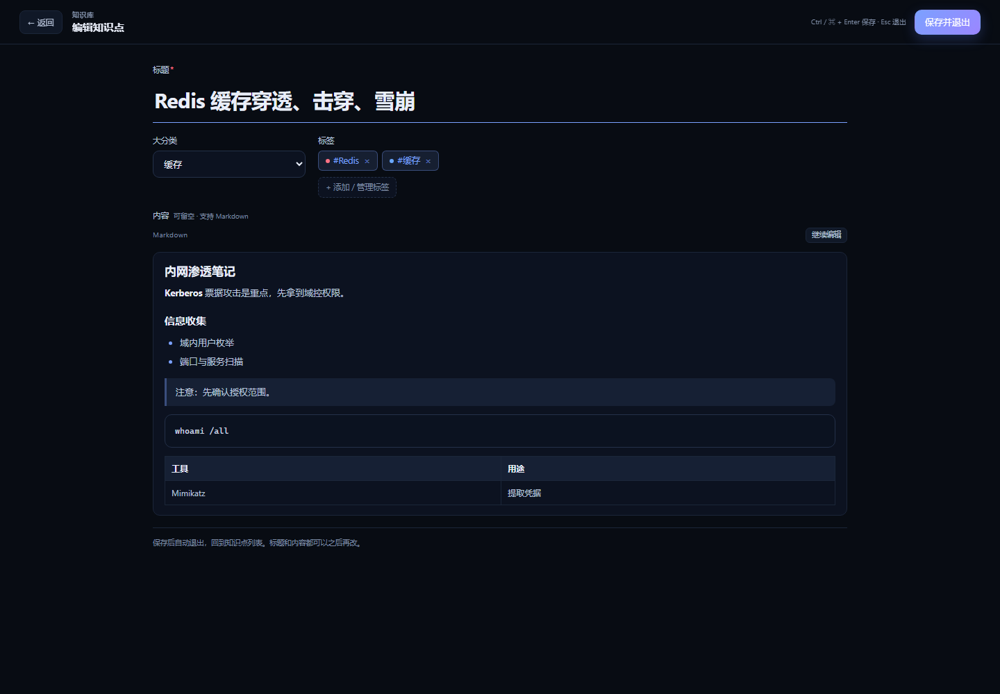
</p>

<p align="center">
  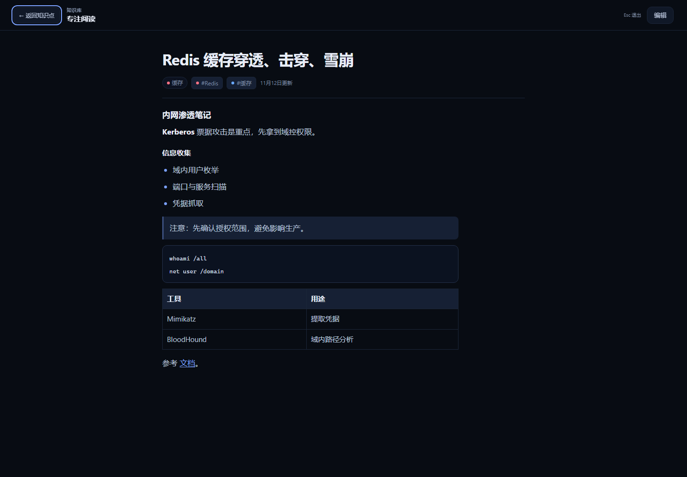
</p>

## 知识点大分类

标签是细粒度标记，知识点还可以有一个独立的大分类，例如「内网渗透 / Java / 免杀」：

- 知识点列表顶部按分类筛选
- 编辑知识点时直接选分类，没有就选「＋ 新建分类」
- 「分类管理」支持添加、改名、删除
- 改名会同步所有知识点；删除分类会把它们归到「未分类」
- 分类和标签互不影响，可以同时使用

<p align="center">
  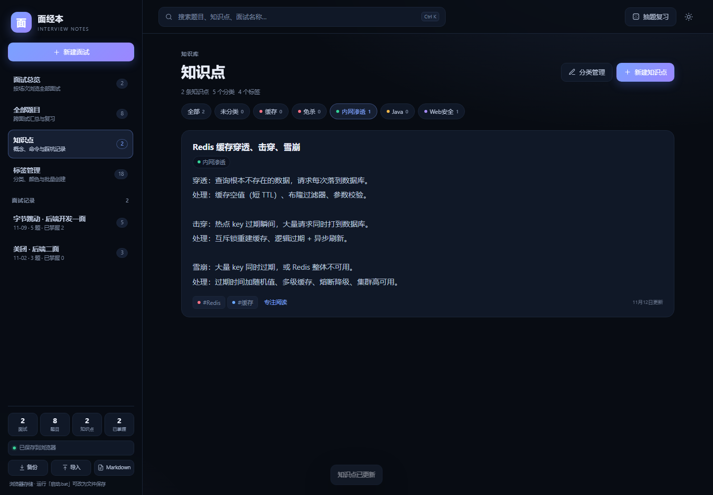
</p>

<p align="center">
  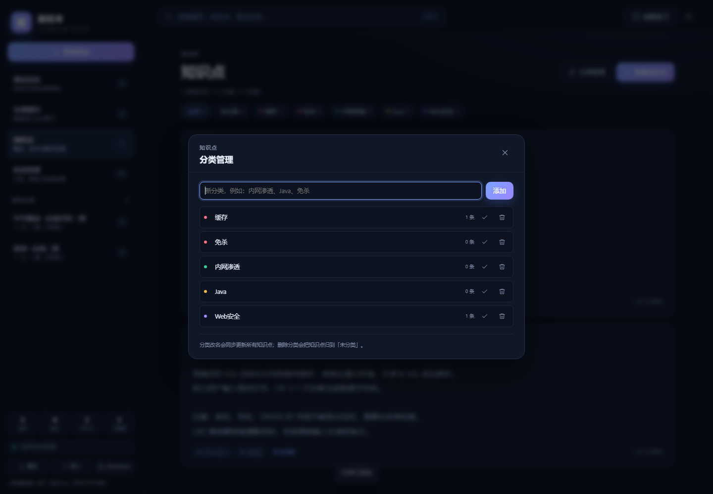
</p>

## 快速开始

### 环境要求

- [Node.js](https://nodejs.org/) 18 或更高版本
- Windows / macOS / Linux 均可

### Windows

双击 **`启动.bat`**。

- 会自动启动本地服务并打开浏览器
- 默认地址：<http://127.0.0.1:8788/>
- 端口被占用时自动尝试 `8789`、`8790` 等
- 关闭命令行窗口即停止服务

### macOS / Linux

```bash
npm start
# 或者
node server.js
```

然后在浏览器打开终端里输出的地址（默认 `http://127.0.0.1:8788/`）。

### 纯浏览器模式

直接双击 `public/index.html` 也能使用全部界面功能，此时数据保存在当前浏览器的 `localStorage` 中。

适合临时试用；换浏览器、清理缓存后数据不互通。

## 数据是怎么存的

文件模式下，数据保存在：

```text
data/mianjing.json
```

每次修改都会：

1. 先发起一次 `PUT /api/data` 请求
2. 服务端把旧文件复制为 `data/mianjing.backup.json`
3. 新内容写入 `data/mianjing.json.tmp`
4. 用临时文件原子替换 `mianjing.json`

也就是说，每次保存都会保留上一版；写入过程不会把原文件写坏。左下角会显示「保存中 / 已保存 / 保存失败」。

> `data/` 已加入 `.gitignore`，个人数据不会随仓库上传。  
> 需要迁移时，用左下角「备份 / 导入」，或直接复制 `data/mianjing.json`。

## 搜索逻辑

搜索不再把所有结果都当题目展示，而是分成三类：

| 类型 | 匹配范围 | 展示形式 |
| --- | --- | --- |
| 面试 | 名称、标签、备注、日期、来源 | 面试卡片 |
| 题目 | 题目内容、答案、标签 | 题目卡片 |
| 知识点 | 标题、内容、标签 | 知识点卡片 |

结果页顶部有「全部 / 面试 / 题目 / 知识点」切换，并显示各自数量。

- 默认「全部」，按面试 → 题目 → 知识点分组
- 切换分类只筛选当前关键词
- 输入新的关键词会自动回到「全部」
- 从面试总览、全部题目或搜索结果进入面试后，顶部显示「返回全部面试 / 返回全部题目 / 返回搜索结果」，会保留关键词、分类或筛选条件、滚动位置；按 `Esc` 也能返回

## 数据结构

```json
{
  "version": 1,
  "interviews": [
    {
      "id": "iv_xxx",
      "name": "字节跳动 · 后端开发一面",
      "date": "2026-11-12",
      "tags": ["后端"],
      "notes": "45 分钟",
      "sourceUrl": "https://example.com/post/1",
      "questions": [
        {
          "id": "q_xxx",
          "content": "Redis 为什么快？",
          "answer": "……",
          "tags": ["Redis"],
          "difficulty": 2,
          "status": "todo",
          "createdAt": "2026-11-12T08:00:00.000Z",
          "updatedAt": "2026-11-12T08:00:00.000Z"
        }
      ]
    }
  ],
  "knowledge": [
    {
      "id": "kn_xxx",
      "title": "Redis 缓存穿透、击穿、雪崩",
      "content": "穿透：查询不存在的数据……",
      "category": "缓存",
      "tags": ["Redis", "缓存"],
      "sourceInterviewId": "iv_xxx",
      "sourceInterviewName": "字节跳动 · 后端开发一面",
      "sourceQuestionId": "q_xxx",
      "createdAt": "2026-11-12T08:00:00.000Z",
      "updatedAt": "2026-11-12T08:00:00.000Z"
    }
  ],
  "knowledgeCategories": [
    {
      "id": "kc_xxx",
      "name": "缓存",
      "color": "red",
      "createdAt": "2026-11-12T08:00:00.000Z",
      "updatedAt": "2026-11-12T08:00:00.000Z"
    }
  ],
  "tagLibrary": [
    {
      "id": "tg_xxx",
      "name": "Redis",
      "group": "技术栈",
      "color": "red",
      "createdAt": "2026-11-12T08:00:00.000Z",
      "updatedAt": "2026-11-12T08:00:00.000Z"
    }
  ]
}
```

- `difficulty`：`0` 未标注 / `1` 简单 / `2` 中等 / `3` 困难
- `status`：`todo` 待复习 / `learning` 复习中 / `mastered` 已掌握
- `knowledgeCategories`：知识点大分类；知识点的 `category` 存分类名
- `tagLibrary`：标签库，`group` 是类型，`color` 是颜色 key
- `sourceInterviewId` / `sourceQuestionId`：从题目转为知识点时记录的原题位置，用于卡片上的回跳
- 知识点 `content` 和题目 `answer` 以 Markdown 原文保存，展示时再渲染

## 项目结构

```text
.
├── server.js                 # 零依赖 Node 服务：静态文件 + 数据读写 API
├── package.json
├── 启动.bat                  # Windows 一键启动
├── public/
│   ├── index.html
│   └── assets/
│       ├── css/styles.css
│       └── js/
│           ├── store.js      # 数据层：文件模式 / 浏览器模式
│           └── app.js        # 界面与交互
├── data/                     # 运行时生成，默认不提交
│   └── .gitkeep
└── preview/                  # README 截图
```

## 开发说明

- 前端是原生 HTML / CSS / JavaScript，没有构建步骤
- 后端只使用 Node.js 内置模块，没有运行时依赖
- 修改 `public/` 下的文件后刷新浏览器即可
- 修改 `server.js` 后需要重启服务
- 数据 API：
  - `GET /api/data`：读取完整数据
  - `PUT /api/data`：保存完整数据

## 常见问题

**启动时报端口被占用？**

默认会自动尝试下一个端口。也可以手动指定：

```bat
set PORT=8899 && node server.js
```

macOS / Linux：

```bash
PORT=8899 node server.js
```

**直接打开 `public/index.html` 为什么看不到文件数据？**

那是浏览器存储模式。要读取 `data/mianjing.json`，请用 `启动.bat` 或 `node server.js` 启动本地服务。

**换电脑怎么迁移？**

在旧电脑点「备份」导出 JSON，在新电脑点「导入」选择该文件；或者直接复制 `data/mianjing.json`。

**怎么清空数据重新开始？**

停止服务，删除 `data/mianjing.json`（可先备份），再启动即可。注意 `data/mianjing.backup.json` 里可能还有上一版。

**GitHub 上为什么没有 `data/mianjing.json`？**

个人面经数据默认不提交，`.gitignore` 已忽略 `data/`。这样仓库可以公开分享，也不会泄露自己的面试记录和第三方内容。

**能直接部署到 GitHub Pages 吗？**

GitHub Pages 只能托管静态文件。可以打开 `public/index.html` 使用浏览器存储模式；文件存储和备份 API 需要本地 Node 服务。

## 说明

- 仓库只包含代码、文档和示例截图
- 本项目代码可自由学习、修改和二次开发
